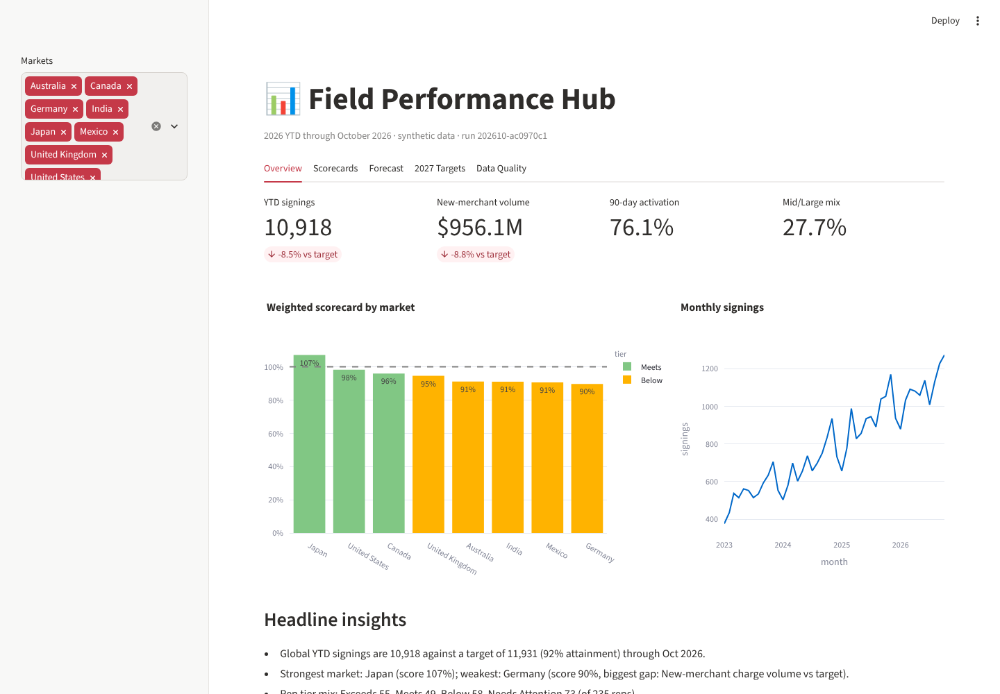
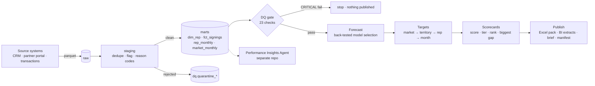
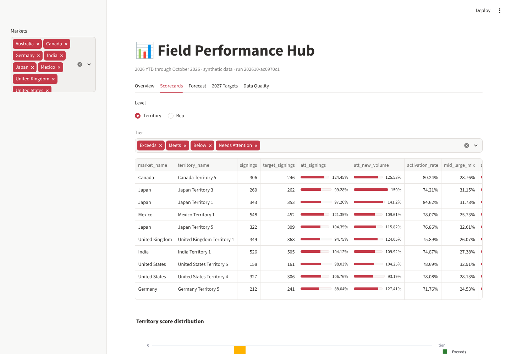
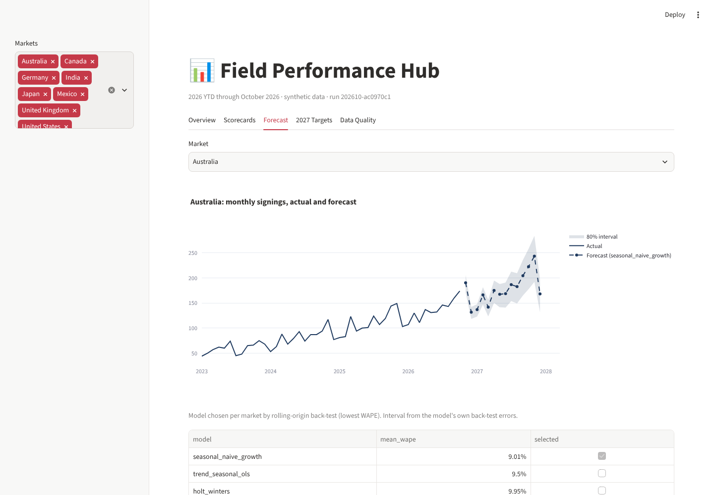
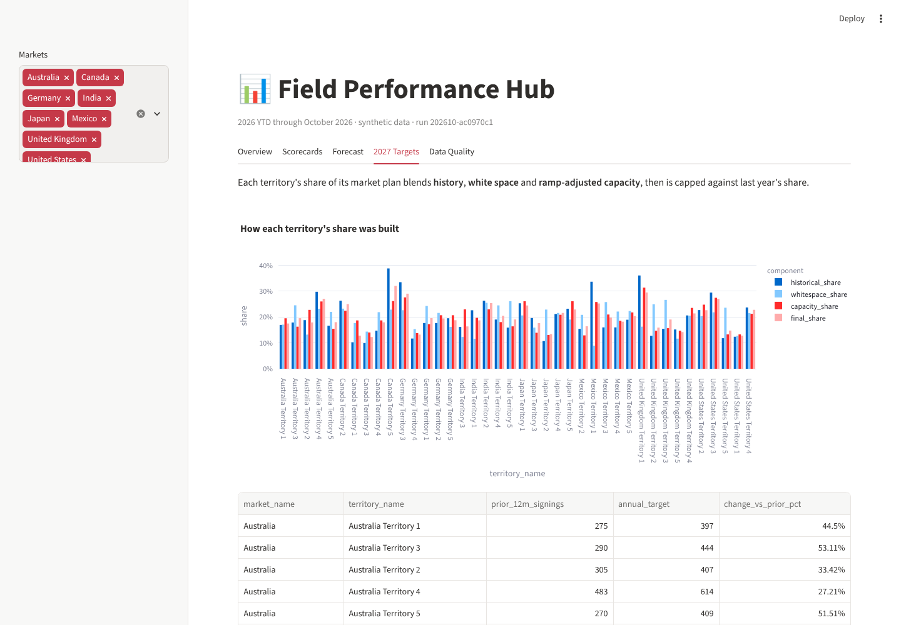
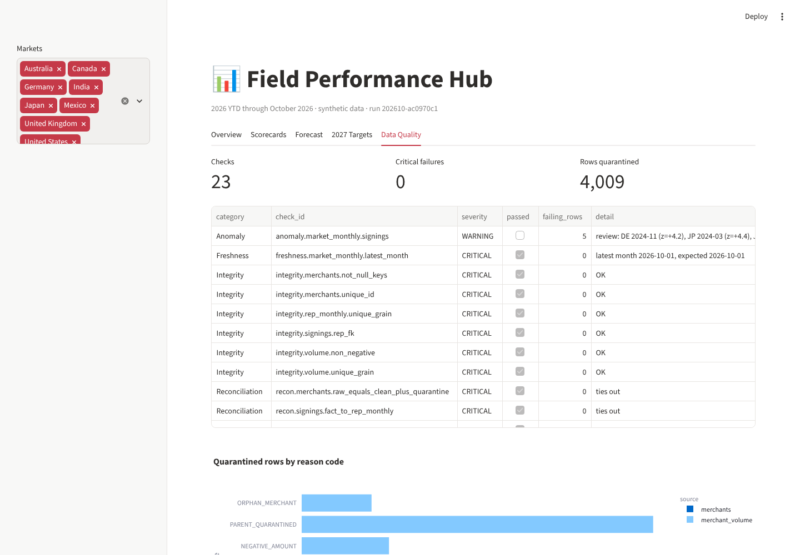

# 📊 Field Performance Hub

**An automated monthly close for a sales organisation: governed data, back-tested forecasts, explainable targets, and weighted scorecards, produced from one command in about 6 seconds.**

Sales planning and enablement teams spend days each month copying extracts into Excel, rebuilding scorecards by hand, and answering "why is my target so high?". This project automates that whole loop for a simulated global merchant-acquisition sales force (8 markets, 40 territories, 235 reps, 37k merchant signings, 477k monthly volume rows). It also treats **data governance as a first-class feature**, not an afterthought.

```bash
pip install -e ".[dev]"
python -m fph.pipeline run          # generate → model → DQ gate → forecast → targets → scorecards → publish
streamlit run app/dashboard.py      # explore it
```



---

## What it does

| Stage | What happens | Why it matters |
|---|---|---|
| **Ingest** | Synthetic source data with realistic defects: duplicates, orphan keys, negative amounts, future dates | Real source systems are messy, so the pipeline has to prove it handles that |
| **Model** | 8 layered SQL models (staging → marts), run by a small dbt-style runner on DuckDB | Same SQL runs locally for free *and* on **BigQuery** (auto-transpiled with sqlglot) |
| **Data-quality gate** | 23 checks across validity, integrity, reconciliation, freshness and anomaly detection. Bad rows are **quarantined with reason codes**, never silently dropped. Any CRITICAL failure stops publishing. | Every published number reconciles back to source: `raw = clean + quarantined` |
| **Forecast** | Three models compete per market in a rolling-origin back-test; the lowest WAPE wins. Intervals come from the winner's own historical errors | **5–12% WAPE** per market; uncertainty is measured, not assumed |
| **Target setting** | Market plan = forecast × (1 + stretch), split to territories by a blend of history, white space and ramp-adjusted capacity, with a change cap, then to reps by tenure ramp | Every target can be explained line by line to a sales leader |
| **Scorecards** | Weighted KPIs (signings, new-merchant volume, 90-day activation, Mid/Large mix) → score, tier, rank, and **biggest gap** per rep, territory and market | Tells a manager where to coach, not just who is behind |
| **Publish** | Formatted Excel pack with conditional formatting, Tableau/Power BI extracts, a rule-based insights brief, and a run manifest | Ready for leadership on day 1 of the month; fully auditable |
| **Automate** | GitHub Actions runs the tests and the full close on the 2nd of every month, then uploads the pack | Nobody runs it by hand |

## Architecture



## Results from the default run (as of Oct 2026)

| | |
|---|---|
| Injected source defects caught | **100%, exact counts** (verified by tests against ground truth) |
| Reconciliation checks | 5 / 5 tie out to the row and the cent |
| Forecast back-test WAPE | 5.4% (Germany) to 11.7% (UK); mean 8.3% |
| Pipeline runtime | ~6 s end to end; 20 tests in ~10 s |
| Outputs | 7-sheet Excel pack, 4 BI extracts, insights brief, run manifest |

## Screenshots

| Scorecards | Forecast with back-tested interval |
|---|---|
|  |  |
| **Explainable 2027 targets** | **Data quality and quarantine** |
|  |  |

## Design decisions

- **Business rules live in [`src/fph/settings.yaml`](src/fph/settings.yaml), not code.** KPI weights, goals, tiers, stretch, allocation weights and ramp bands can change without a deploy, and the config is validated on load (weights must sum to 1).
- **Quarantine, don't delete.** Each rejected row keeps one reason code (`DUPLICATE_RECORD`, `ORPHAN_REP`, `PARENT_QUARANTINED` …), so source owners get a remediation list instead of a mystery gap.
- **Ratios are computed from sums, never averaged.** Territory attainment is Σactual / Σtarget, so small territories can't distort the total.
- **Fair activation KPI.** A signing only counts toward the 90-day activation rate once its window has closed, so recent signings never drag reps down.
- **Targets back-tested too.** This year's targets are rebuilt *as of last December*, so the YTD scorecard measures reps against the targets they would actually have received.
- **Volume and signings targets stay consistent.** The volume target comes from the historical "volume per YTD signing" curve, so the two KPIs can't contradict each other.
- **Run anywhere.** DuckDB locally; `python -m fph.warehouse --to-bigquery` + [`scripts/load_to_bigquery.sh`](scripts/load_to_bigquery.sh) for GCP (works on the free BigQuery sandbox).

## Project structure

```
src/fph/
  settings.yaml             business rules (weights, goals, tiers, stretch, ramp)
  sql/staging, sql/marts    SQL models (one SELECT per file, run in order)
  generate.py               synthetic org + defects with ground truth
  warehouse.py              model runner, run params (as-of), BigQuery transpile
  dq.py                     validity / integrity / reconciliation / freshness / anomaly
  forecast.py               3 models, rolling-origin back-test, empirical intervals
  targets.py                explainable allocation with caps and ramp
  scorecard.py              weighted score, tiers, ranks, biggest gap
  export.py                 Excel pack, BI extracts, insights brief
  pipeline.py               orchestration, run manifest, ops.run_log
app/dashboard.py            Streamlit dashboard (5 tabs)
tests/                      20 tests: DQ ground truth, reconciliation, targets roll-up, scoring, UI
.github/workflows/          scheduled monthly close + CI
```

## Run it

```bash
make install      # pip install -e ".[dev]"
make run          # full pipeline → exports/
make test         # pytest
make dashboard    # streamlit
python -m fph.pipeline run --as-of 2026-06-01   # rebuild any historical month
```

**Tableau Public / Power BI:** connect to `exports/bi/*.csv` (rep_monthly, rep_scorecard, forecast, targets).

## Companion project

[**Performance Insights Agent**](https://github.com/geniusishan/performance-insights-agent): a governed AI agent that answers natural-language questions on this warehouse, with code-enforced SQL guardrails, self-correction, hallucination checks on numbers, audit logging and an evaluation suite.

---
*All data is synthetic and generated by `src/fph/generate.py`. No real company or customer data is used.*
